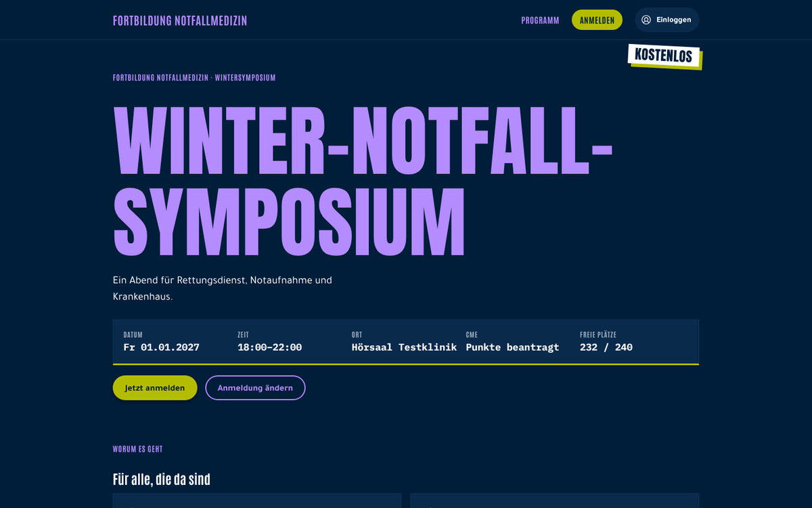
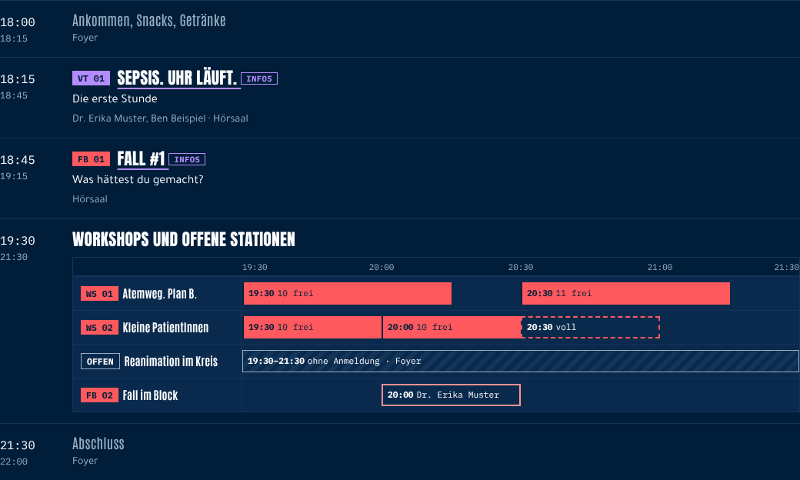
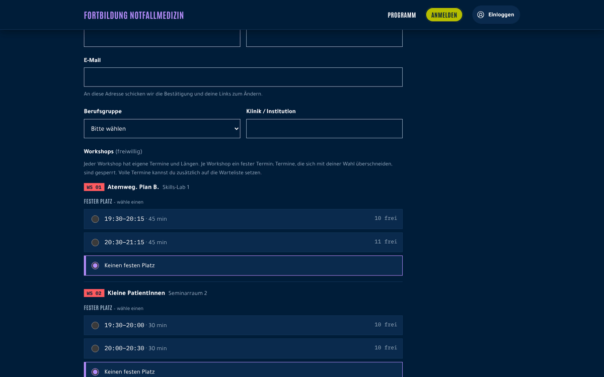
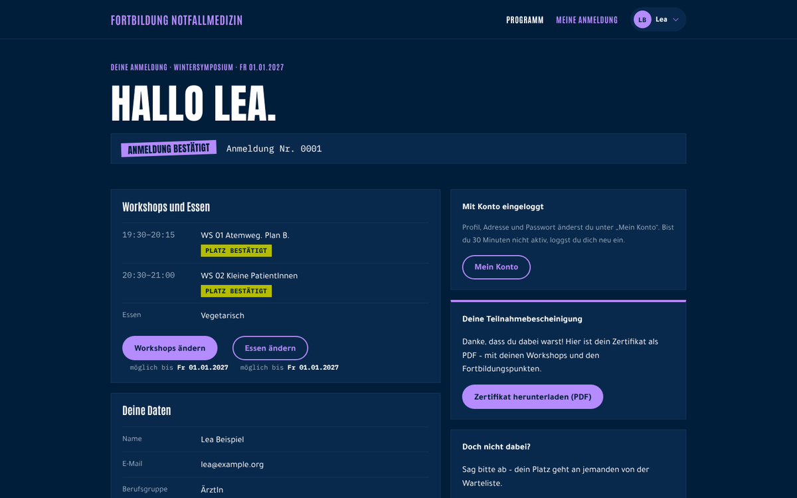
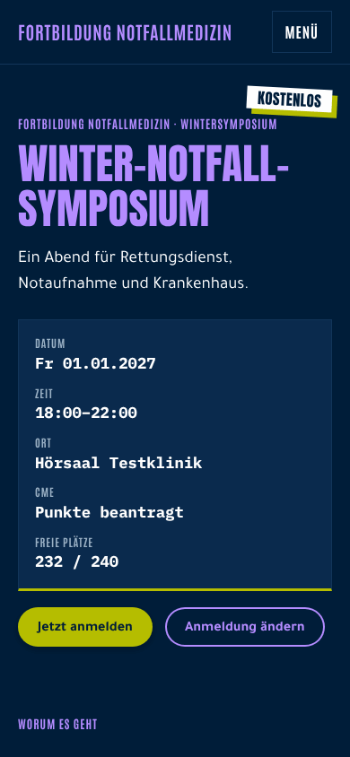
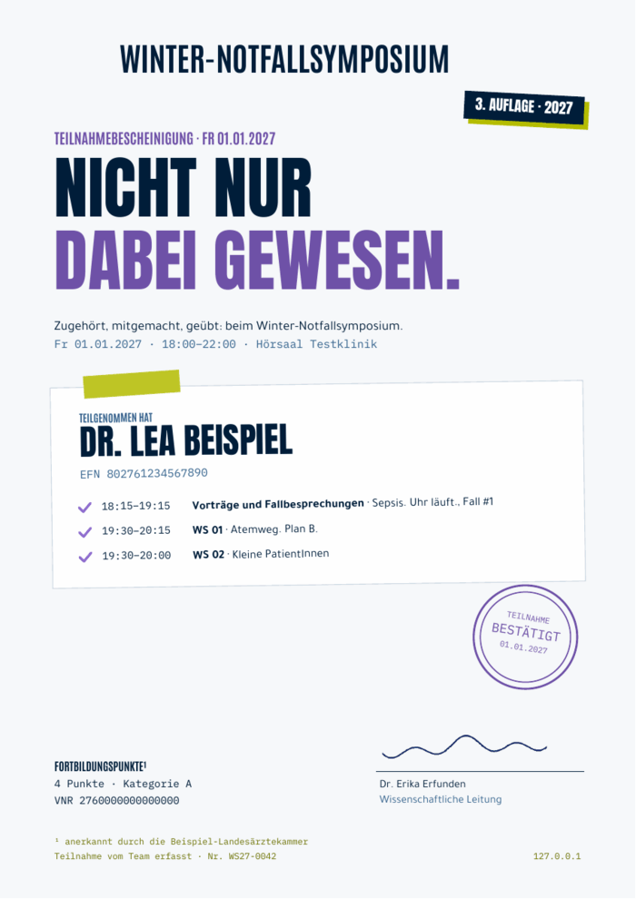
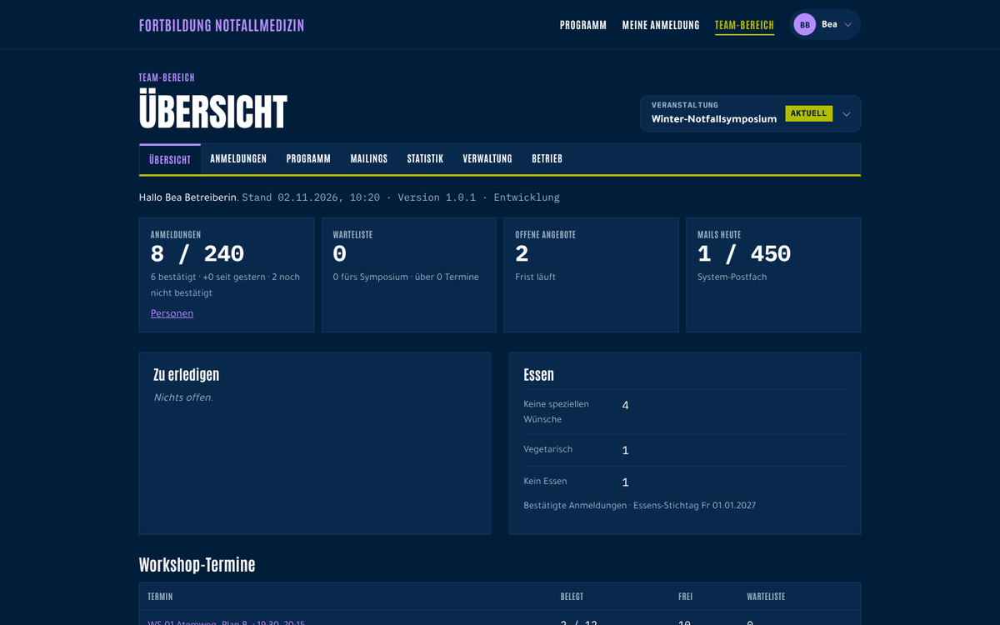
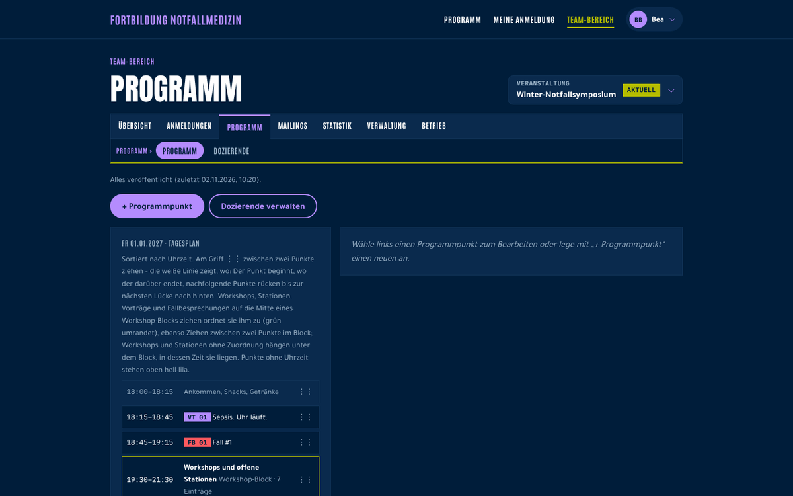
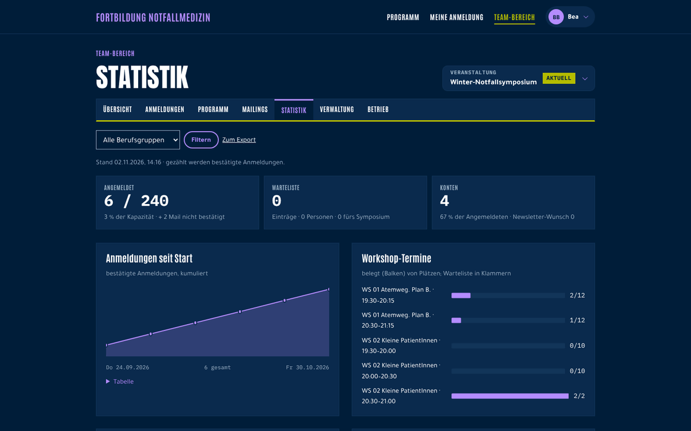
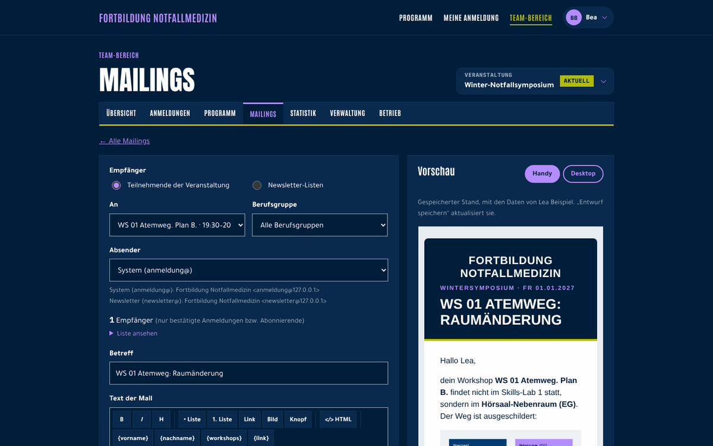

# Wintersymposium – Anmeldung und Organisation für Fortbildungen

Webanwendung für **Fortbildungsveranstaltungen mit Programm, Workshops und begrenzten Plätzen**: eine öffentliche Seite mit Programm, die Anmeldung mit Workshop-Wahl und Warteliste und ein Team-Bereich, in dem die Organisation alles verwaltet – vom Programm über Mailings bis zur Teilnahmebescheinigung.

Entstanden für ein jährliches Notfallmedizin-Symposium (rund 250 Teilnehmende, abends, mit parallelen Workshops). Sie passt aber auch zu Vortragsabenden, Journal Clubs oder Workshop-Abenden, mit oder ohne Workshops, Essenswahl und Fortbildungspunkte. Mehrere Veranstaltungen und Veranstaltungsreihen laufen in einer Installation.

**Stand:** Version 1.0, im Einsatz. Version in [`VERSION`](VERSION), Änderungen in [`CHANGELOG.md`](CHANGELOG.md).

## Funktionen

### Für Teilnehmende

- **Startseite** mit Eckdaten (Datum, Ort, freie Plätze), pflegbaren Texten und dem **Programm** als Zeitraster: Vorträge, Fallbesprechungen, Workshops mit mehreren Terminen, offene Stationen und Pausen; Details zu jedem Punkt und den Dozierenden im Popup. Auf dem Handy als Liste.
- **Anmeldung** mit Workshop-Wahl: je Workshop ein fester Termin, Überschneidungen werden gesperrt, volle Termine lassen sich auf die Warteliste setzen. Essenswahl und Einheitliche Fortbildungsnummer (EFN) auf Wunsch.
- **Bestätigung per Mail**; bis dahin bleiben die Plätze reserviert. Ist das Symposium voll, geht es auf die Warteliste.
- **Nachrücken**: Wird ein Platz frei, bekommt die nächste Person auf der Warteliste ein Angebot mit Frist per Mail – annehmen oder ablehnen mit einem Klick.
- **Meine Anmeldung**: Workshops, Essen und Daten ändern oder absagen, ohne Konto über einen Einmal-Link per Mail oder mit einem **freiwilligen Konto** (Passwort oder Passkey).
- **Teilnahmebescheinigung** als PDF nach der Veranstaltung, mit Workshops und Fortbildungspunkten.
- **Newsletter** mit Double-Opt-In, je Veranstaltungsreihe und übergreifend.

| Programm | Anmeldung mit Workshop-Wahl |
|---|---|
|  |  |

| Meine Anmeldung | Startseite am Handy | Teilnahmebescheinigung |
|---|---|---|
|  |  |  |

### Für das Team

- **Übersicht** mit Anmeldungen, Warteliste, offenen Angeboten, Mailstand und einer Liste „Zu erledigen“.
- **Programm-Pflege**: Tagesplan zum Ziehen, Workshops mit Terminen und Plätzen, Dozierende mit Foto; Änderungen erst speichern, dann veröffentlichen.
- **Personen und Workshops**: suchen, filtern, Anmeldungen ändern, Plätze von Hand vergeben oder anbieten, überbuchen nur mit Bestätigung.
- **Mailings** an Angemeldete, Wartelisten oder einzelne Workshop-Termine und **Newsletter** an Listen: Editor mit Bildern, Platzhaltern und Vorschau, geplanter Versand, Tageslimit je Postfach.
- **Statistik** und **Exporte** als CSV, Excel und PDF: Teilnehmendenliste, Essensliste, Unterschriftenliste mit EFN-Barcode, CME-Liste.
- **Teilnahme und Zertifikate**: Anwesenheit erfassen, Bescheinigungen freischalten.
- **Einstellungen je Veranstaltung**: Kapazität, Fristen, Stichtage, Bausteine (Workshops, Essen, Fortbildungspunkte, Bescheinigung) – nichts davon steht fest im Code.
- **Mehrere Veranstaltungen und Reihen**, Rechte für Admins je Veranstaltung oder Reihe, Protokoll aller Änderungen. Jede Veranstaltung kann ein **eigenes Icon** haben (links oben, im Browser-Tab, in der Linkvorschau).
- **Linkvorschau und Suchmaschinen**: Geteilte Links zeigen in Messengern Titel, Datum, Ort und Bild; Suchmaschinen bekommen Beschreibung, strukturierte Daten zur Veranstaltung, `sitemap.xml` und `robots.txt` – alles automatisch aus den Einstellungen und erst freigegeben, wenn eine BetreiberIn es einschaltet.
- **Betrieb**: Status-Seite mit Ampeln (Cron, Mail, Datenbank, Sicherung), automatische Sicherung mit Wiederherstellen, Wartungsmodus, Team-Konten mit Rollen.

| Team-Übersicht | Programm-Pflege |
|---|---|
|  |  |

| Statistik | Mailing-Editor mit Vorschau |
|---|---|
|  |  |

Die Bilder zeigen erfundene Beispieldaten; Logo und Name der Marke sind darin durch einen neutralen Schriftzug ersetzt. Erzeugt mit `node tools/browser/readme_bilder.js`.

## Datenschutz und Sicherheit

- **Keine fremden Dienste:** kein Tracking, keine Analyse, keine Schriften oder Skripte von fremden Servern. Alles läuft auf dem eigenen Webspace.
- **Daten werden gelöscht:** Anmeldungen ohne Konto 14 Monate nach der Veranstaltung, Konten nach 14 Monaten ohne Login (mit Erinnerung), Protokolle und Mail-Inhalte nach festen Fristen. Nachweise über Fortbildungspunkte bleiben getrennt 10 Jahre erhalten.
- **Sparsam gespeichert:** IP-Adressen nie im Klartext, nur als Prüfsumme für den Schutz vor zu vielen Versuchen; Einmal-Links nur als Hash.
- **Team-Zugang** nur mit zweitem Faktor (Authenticator-App, Code per Mail oder Passkey); heikle Aktionen fragen ihn erneut ab.
- **Schutz der Formulare** ohne Captcha-Dienst: Rechenaufgabe im Browser, Honigtopf, Zeitsperre, Wegwerfadressen.
- Sicherheits-Kopfzeilen (Content-Security-Policy, HSTS), Schutz vor Cross-Site-Request-Forgery, gleiche Antworten für bekannte und unbekannte Adressen.

## Voraussetzungen

- Webspace mit **PHP 8.3** (Erweiterungen PDO MySQL, OpenSSL, mbstring, GD, zlib) und **MySQL 8**
- **HTTPS** für die Domain
- ein **Cronjob** alle 5 Minuten (Mails, Nachrücken, Sicherung, Löschfristen)
- ein Postfach mit SMTP-Zugang für den Versand

Kein Framework, kein Composer, kein Build-Schritt: Der Ordner `server/` wird so hochgeladen, wie er ist.

## Installation in Kürze

1. `server/` auf den Webspace kopieren; die Domain zeigt auf `server/public/`.
2. Eine leere MySQL-Datenbank anlegen.
3. `server/config.example.php` als `config.php` kopieren und ausfüllen (Datenbank, Zufallswerte, Mail).
4. `https://<domain>/install` öffnen und das erste Team-Konto anlegen.
5. Den Cronjob einrichten; Befehl und Zeitplan zeigt die Status-Seite im Team-Bereich.

Alles Weitere – Auslieferung per GitHub Actions, Staging und Produktion, Sicherung, Tests – steht in [`docs/betrieb.md`](docs/betrieb.md).

## Grenzen

- Oberfläche und Mails nur auf **Deutsch**.
- Ausgelegt auf Veranstaltungen mit **einigen hundert** Teilnehmenden; das Mail-Tageslimit des Hosters setzt die Grenze für Rundmails.
- **Keine Bezahlfunktion**: gedacht für kostenlose Veranstaltungen.
- Erscheinungsbild (Farben, Schriften, Logo) ist auf die ursprüngliche Veranstaltung zugeschnitten und steht in `server/public/assets/site.css` und `server/lib/html_lib.php`; wer die Software selbst nutzt, ersetzt Logo und Namen (siehe Lizenz).

## Dokumentation

- [`docs/betrieb.md`](docs/betrieb.md) – Einrichtung, Auslieferung, Bedienung, Wartung, Tests
- [`docs/konzept.md`](docs/konzept.md) – Entscheidungen, Regeln, Arbeitspakete, offene Punkte
- [`docs/pruefprotokoll.md`](docs/pruefprotokoll.md) – geplante und durchgeführte Prüfungen
- [`CHANGELOG.md`](CHANGELOG.md) – Änderungen je Version
- [`CLAUDE.md`](CLAUDE.md) – Hinweise für die KI-gestützte Entwicklung

Tests: `php tools/tests/lauf.php` (mit Testdatenbank) und der Browser-Durchlauf `node tools/browser/durchlauf.js` in Chromium, Firefox und WebKit.

## Sicherheitslücken melden

Bitte **nicht** als öffentliches Issue, sondern privat über GitHub: Reiter **Security** → **Report a vulnerability**. Details in [`SECURITY.md`](SECURITY.md).

## Lizenz

© Philipp Chadid

**Der Code steht unter der [GNU Affero General Public License 3.0](LICENSE) (AGPL-3.0).** In klarer Sprache heißt das:

- Du darfst die Software **kostenlos nutzen, ändern und weitergeben**, auch für deine eigenen Veranstaltungen.
- Gibst du sie weiter – geändert oder nicht –, muss das wieder unter der AGPL-3.0 geschehen, mit Quelltext und diesem Lizenzhinweis.
- **Betreibst du eine geänderte Fassung öffentlich im Netz**, musst du deren Quelltext den Nutzenden anbieten (die Fußzeile verlinkt dafür den Quelltext; zeig dort auf deine Fassung).
- Es gibt **keine Gewährleistung und keine Haftung**: Die Software wird so bereitgestellt, wie sie ist.

Maßgeblich ist allein der Lizenztext in [`LICENSE`](LICENSE).

**Ausgenommen von der AGPL-3.0** sind **Logo und Name „Allgäu Akut“** (Dateien in `server/public/assets/logo/` und `server/pdf/`, Name in Texten und Voreinstellungen). Sie dürfen nicht für eigene Veranstaltungen verwendet werden; wer die Software selbst einsetzt, ersetzt sie durch eigene.

**Fremde Bestandteile** mit eigener Lizenz (Lizenztexte liegen jeweils daneben):

| Bestandteil | Lizenz | Ort |
|---|---|---|
| Schriften Anton, Antonio, IBM Plex Mono, Tajawal | SIL Open Font License 1.1 | `server/public/assets/fonts/`, `server/pdf/` |
| Phosphor Icons | MIT | `server/public/assets/icons/`, `server/lib/vendor/phosphor/` |
| qrcode-generator (Kazuhiko Arase) | MIT | `server/public/assets/vendor/` |
| tFPDF (PDF-Erzeugung) | LGPL-2.1 | `server/lib/vendor/tfpdf/` |

Teile des Codes stammen aus [NAdoku](https://github.com/gen-em/einsatzdoku-luftrettung) (gleicher Urheber, ebenfalls AGPL-3.0).
